<p align="center">
  
</p>

<h1 align="center">Finance Manager</h1>

<p align="center">
  A calm, offline money tracker for Android, part of the Oxygen Theme family.<br>
  Accounts, savings jars, categories and statistics. No account, no cloud, no tracking: your money data stays on your phone.
</p>

<p align="center">
  <picture>
    <source media="(prefers-color-scheme: dark)" srcset="docs/banner-dark.png">
    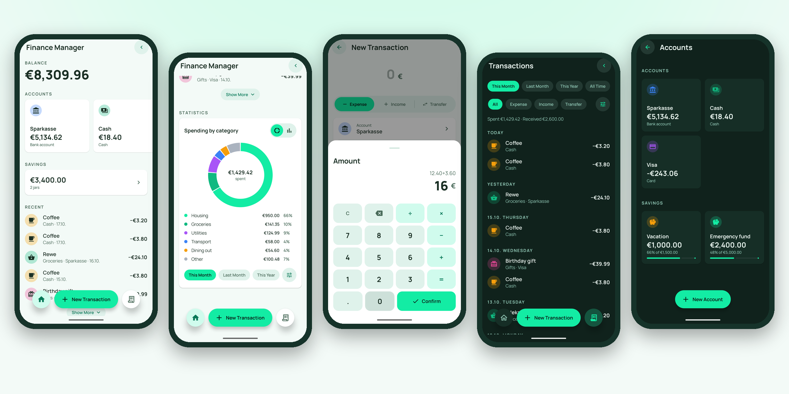
  </picture>
</p>

**Version:** F 51 u · **Android:** 8.0+ (API 26) · **Languages:** English, Ukrainian · **License:** MPL 2.0

---

## Why Finance Manager

- **You type it in, and nothing leaves the phone.** There is no bank sync and no SMS reading. The app asks for no permissions at all, not even internet access.
- **One screen tells you where you stand.** Home shows the balance, every account, your savings jars, the latest transactions and a breakdown by category.
- **Money is counted exactly.** Amounts are stored in whole cents, so 0.10 + 0.20 is 0.30, never 0.30000000000000004. A transfer is a single record, so money never appears or disappears between your accounts.
- **Calm, not engineery.** Soft shapes, one mint accent, and the colour belongs to your accounts and categories rather than to the interface.

## Features

### Home
- The total balance, with an option to **leave savings out of it**
- An accounts carousel; scroll to its end and a bubble grows into a **New Account** card
- **Savings jars** on their own panel, with progress towards a goal and a target date
- The last five transactions, with **Show More** to see up to twenty
- **Statistics** for spending or income by category, as a donut or a bar chart, for this month, last month, this year or all time

### Transactions
- **Expense**, **Income** and **Transfer** in one long segmented pill
- A large amount display that opens a **calculator** from below: `12.40 + 3.60` then **Confirm**, and an unfinished sum is worked out for you
- The account, category and date are chosen in sheets: account cards, category pills with subcategories, and a calendar
- Tap any transaction to edit it; **Delete** sits at the very bottom and asks for confirmation
- A **Transactions** screen grouped by day, with filters for period, type, account and category, and a running *Spent · Received* total

### Accounts and savings
- Cash, bank account, card and **savings jar**, in eight currencies: EUR, USD, GBP, PLN, UAH, CHF, CZK and SEK
- An opening balance (a card may start below zero), a colour and an icon
- A savings jar can have a **goal** and a **save-up-by** date
- **Archive** an account to hide it and keep its history, or delete it together with its transactions

### Categories
- 26 categories to start with, translated and renamed freely
- **Subcategories** one level deep. In lists they stay folded behind a short *+2 cat.* pill
- 66 icons and the eight Oxygen `mark-*` colours
- Deleting a subcategory moves its transactions to the parent category; deleting a category is explained before anything happens

### Settings
- Theme: **System**, **Light** or **Dark**
- Interface language: **English** or **Українська**, switched in the app without changing the phone's language. The default categories switch with it, unless you have renamed them
- **Leave savings out of the balance**

## Screenshots

| Home | Statistics | Transactions | Calculator |
|:-:|:-:|:-:|:-:|
| 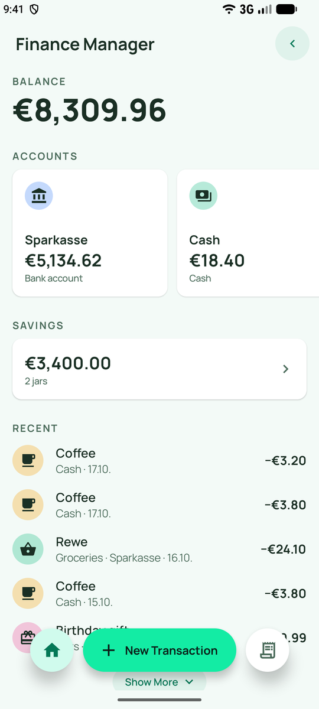 | 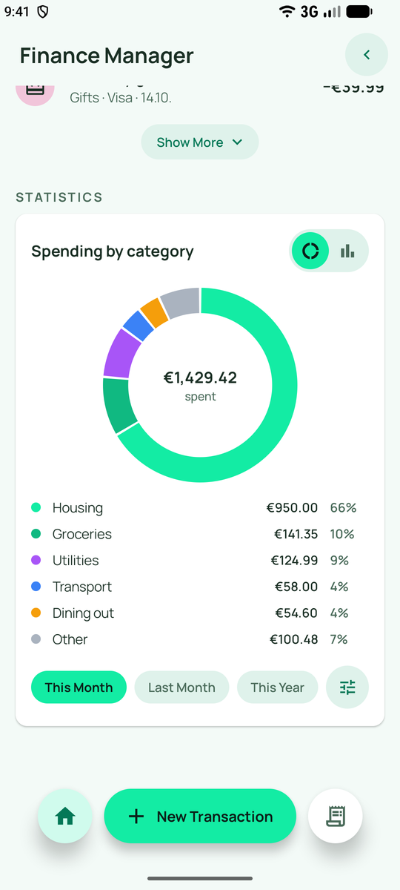 | 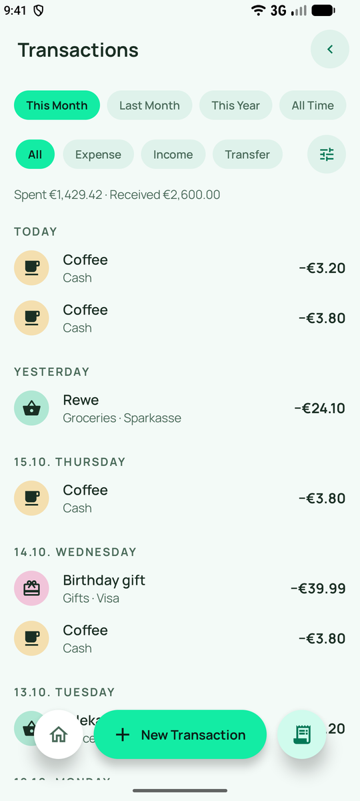 | 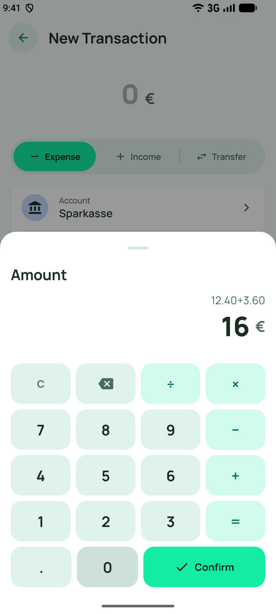 |
| **New transaction** | **Accounts** | **Categories** | **Settings** |
| 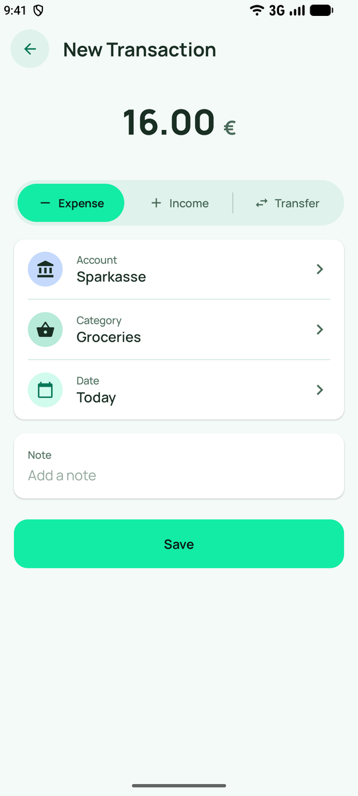 | 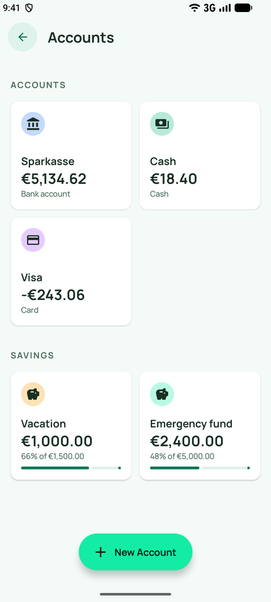 | 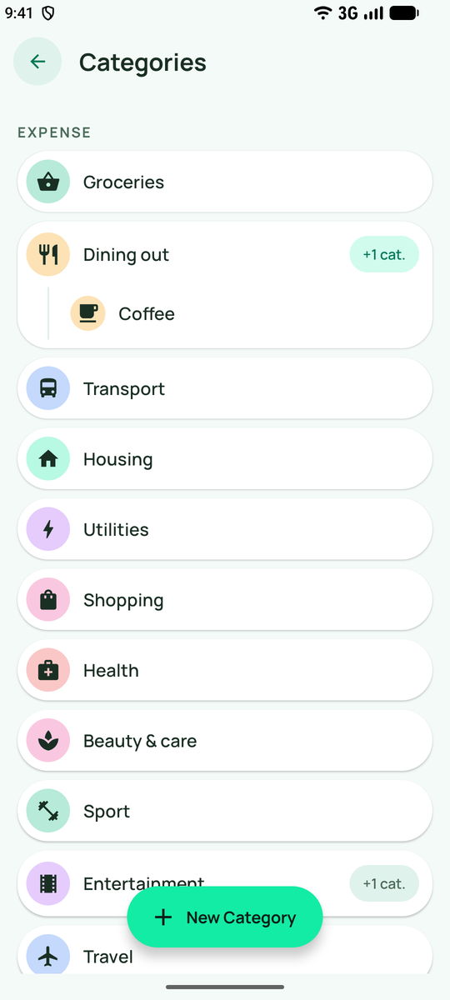 | 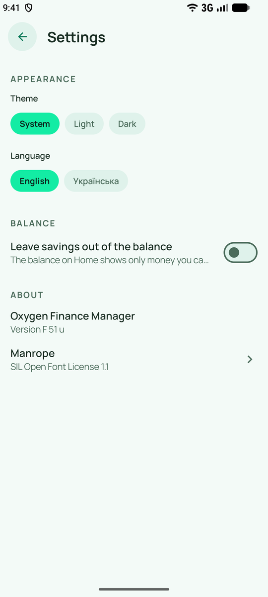 |

<details>
<summary><b>Dark theme</b></summary>

| Home | Statistics | Transactions | Calculator |
|:-:|:-:|:-:|:-:|
| 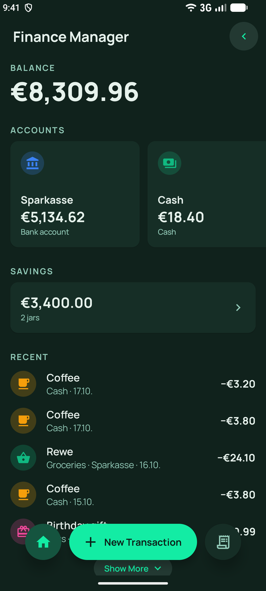 | 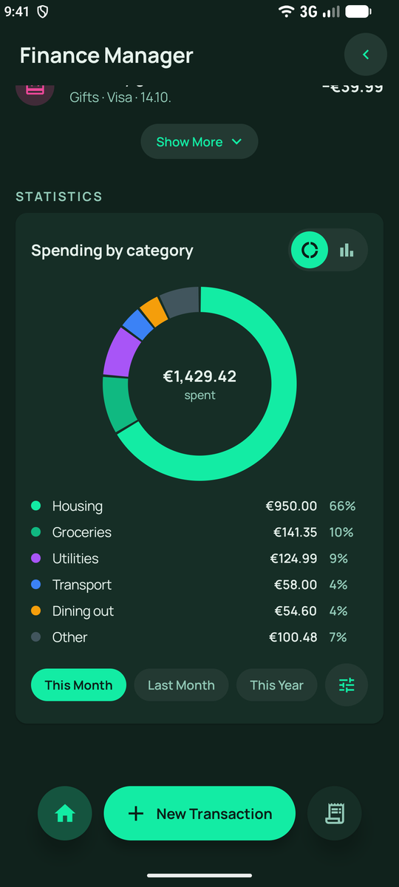 | 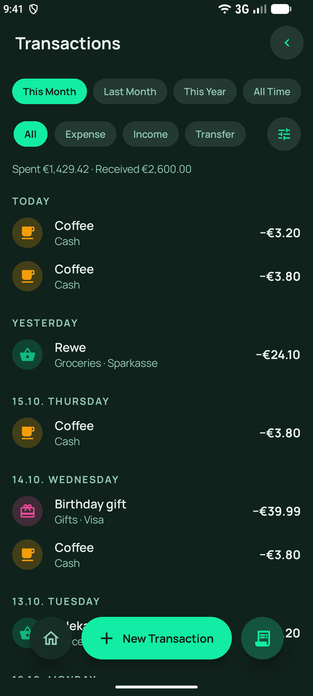 | 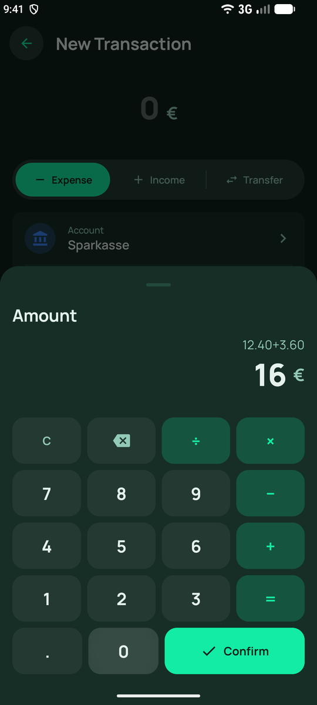 |
| **New transaction** | **Accounts** | **Categories** | **Settings** |
| 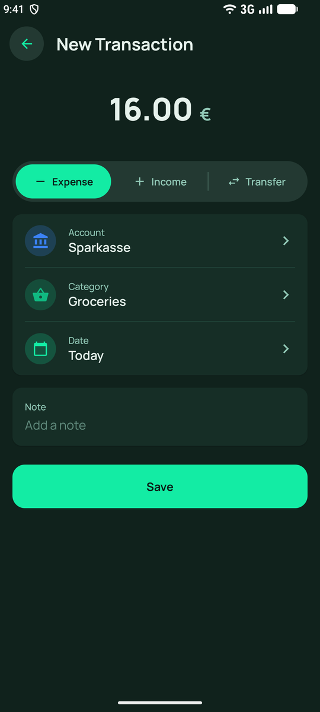 | 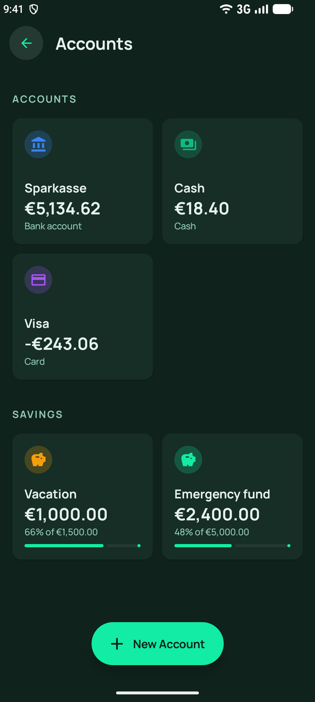 | 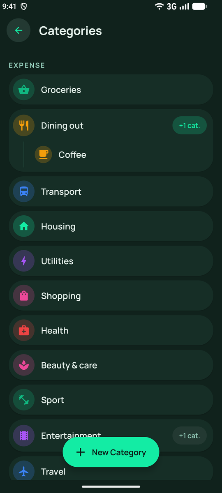 | 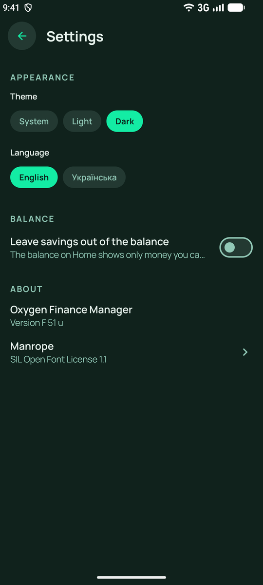 |

</details>

<details>
<summary><b>Українською</b></summary>

| Головна | Статистика | Транзакції | Нова транзакція |
|:-:|:-:|:-:|:-:|
| 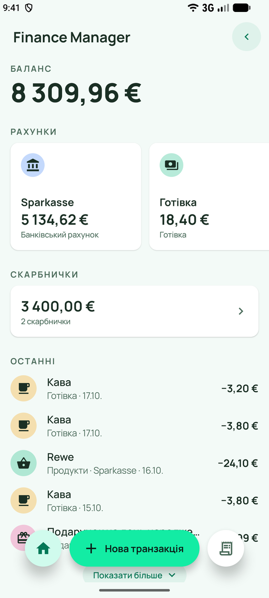 | 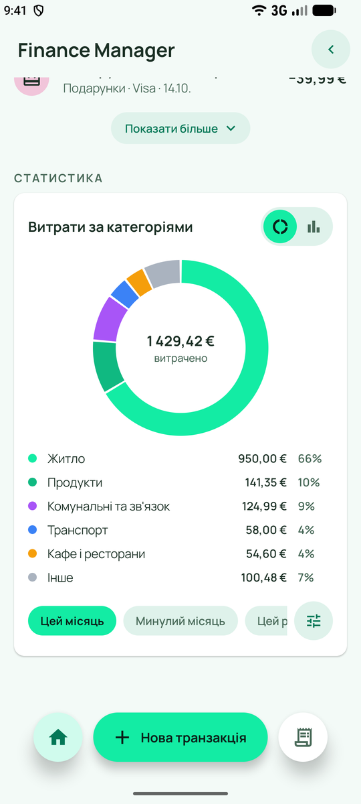 | 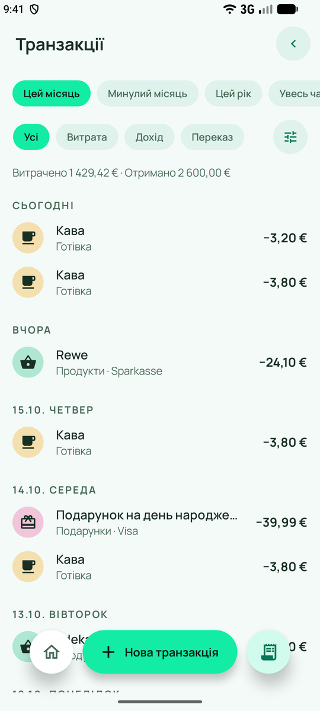 | 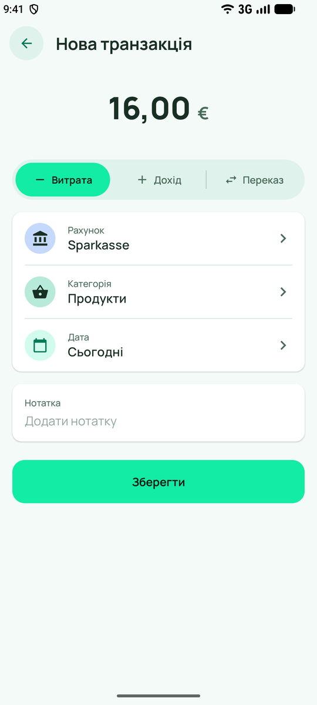 |

</details>

## How the numbers work

| | |
|---|---|
| **Balance** | The opening balance plus every transaction on the account. It is calculated, never stored, so it cannot drift out of step. |
| **Transfers** | One record moves money from one account to another. Transfers are not counted as spending or income in statistics. |
| **Currencies** | Each account has its own currency. Totals are shown per currency, and nothing is converted with a made-up rate. |
| **Statistics** | Subcategories fold into their parent. Pick a category and the chart breaks it down by its subcategories. Beyond six slices, the rest is grouped as *Other*. |
| **Periods** | Months and years start at local midnight, and a transaction at midnight on the 1st belongs to exactly one month. |

## Not there yet

Budgets, recurring payments, reminders, export and backup. All data lives in the app's own storage, so uninstalling the app removes it.

## Install

Download `releases/FinanceManager_F51u.apk`, open it on your phone and allow installing from this source when Android asks.

## Build from source

You need JDK 17 or newer and the Android SDK (platform 36). The project uses Gradle 9.7 and Android Gradle Plugin 9.4.

```bash
./gradlew :app:assembleDebug
```

The APK is written to `app/build/outputs/apk/debug/app-debug.apk`.

```bash
./gradlew :app:testDebugUnitTest
```

82 unit tests cover balances and transfers, amount parsing, the calculator, transaction forms, filters and periods, statistics and category rules.

## Under the hood

- **Kotlin**, **Jetpack Compose** and **Material 3**, themed with Oxygen Theme tokens in a single theme file. Dynamic colour is off on purpose.
- **Room** for accounts, categories and transactions; **DataStore** for settings; **Hilt** for dependency injection; type-safe **Navigation Compose**
- **Charts** are drawn on a Compose `Canvas`, with no chart library
- **Amounts** are `Long` minor units with the currency code; `java.util.Currency` knows how many decimal places each currency has
- **AppCompat per-app languages:** the language choice is stored by the system on Android 13+, and by AppCompat on older versions

```
app/src/main/java/com/oxygen/financemanager/
├── core/        balance math, money formatting and parsing, calculator
├── data/        Room database, default categories, DataStore settings
├── feature/
│   ├── home/          balance, accounts carousel, savings, recent
│   ├── add/           transaction form, calculator and picker sheets
│   ├── transactions/  list grouped by day, filters
│   ├── stats/         donut and bar charts
│   ├── accounts/      accounts and savings jars
│   ├── categories/    categories and subcategories
│   └── settings/      theme, language, balance, licences
├── navigation/
└── ui/          Oxygen components and theme tokens
```

## Translations

The interface strings are in `app/src/main/res/values/strings.xml` (English) and `values-uk/strings.xml` (Ukrainian). To add a language, copy the file into `values-<code>/`, translate it, and add the code to `APP_LANGUAGES` in `data/db/DefaultCategories.kt` and to `localeFilters` in `app/build.gradle.kts`.

## License

Finance Manager is released under the [Mozilla Public License 2.0](LICENSE). You can use, modify and ship it, including inside larger projects; changes to Finance Manager's own files must stay open under the same license.

## Third-party

| | License |
|---|---|
| [Manrope](https://github.com/sharanda/manrope) | SIL Open Font License 1.1 |
| [Material Icons](https://github.com/google/material-design-icons) | Apache License 2.0 |
| [AndroidX](https://developer.android.com/jetpack/androidx), [Dagger Hilt](https://dagger.dev/hilt/), [kotlinx.serialization](https://github.com/Kotlin/kotlinx.serialization) | Apache License 2.0 |

The Manrope license text ships with the app under **Settings → About**.
